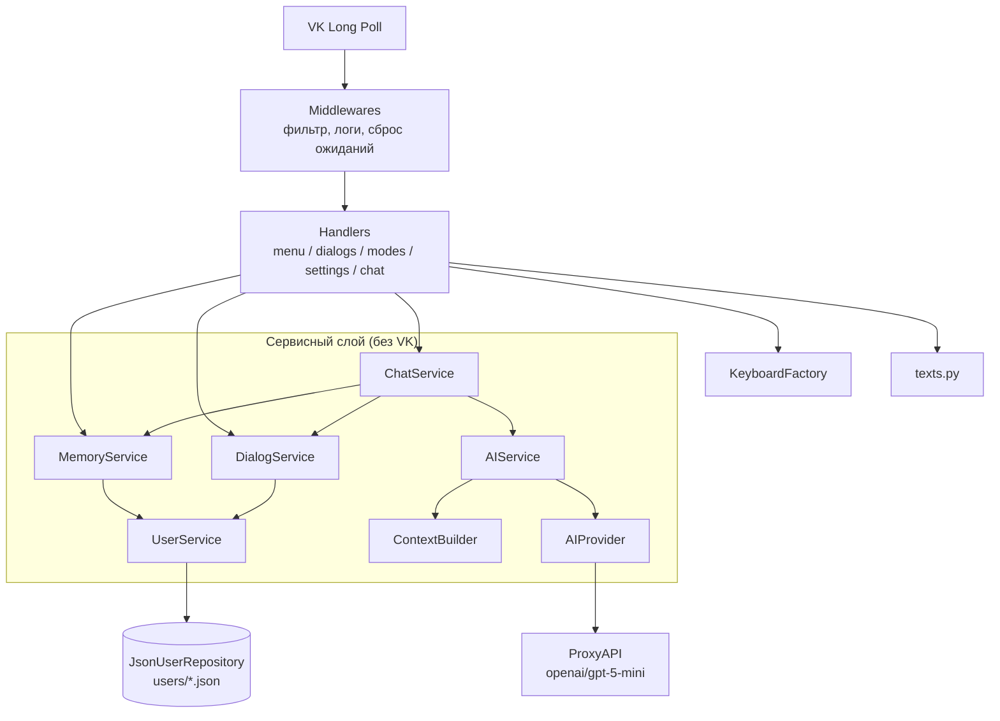

# AI-ассистент для ВКонтакте (VKBottle + ProxyAPI + openai/gpt-5-mini)

Бот для сообщества ВК с многодиалоговым режимом, краткосрочной памятью (100 последних
сообщений на диалог), семью ролями общения, выдачей ответов текстовыми файлами
и хранением состояния в JSON-файлах.
LLM вызывается через [ProxyAPI.ru](https://proxyapi.ru/docs) — OpenAI-совместимый endpoint,
поэтому используется официальный асинхронный SDK `openai` (`AsyncOpenAI`).

## Быстрый старт

```powershell
py -3.14 -m venv .venv
.\.venv\Scripts\python.exe -m pip install -r requirements.txt
copy .env.example .env      # заполнить VK_GROUP_TOKEN и PROXYAPI_KEY
.\.venv\Scripts\python.exe main.py
```

Настройка сообщества ВК:
1. Управление → Работа с API → Ключи доступа — создать ключ с правами «сообщения» и «управление» (для отправки файлов этого достаточно).
2. Работа с API → Long Poll API — включить, версия **5.199** (или новее), тип событий: «Входящее сообщение».
3. Сообщения → Возможности ботов — включить, разрешить добавлять в беседы не обязательно (бот работает в личке).

ProxyAPI: зарегистрироваться, создать ключ `sk-...` в разделе «Ключи API», пополнить баланс.

## Структура проекта

```text
main.py                     точка входа (asyncio.run → bot.run_polling)
config/
  settings.py               Settings из .env (dataclasses, без глобального состояния)
  prompts.py                7 режимов общения = 7 system prompt'ов + инструкция о выдаче файлов
models/                     доменные модели (pydantic) — они же схема JSON
  chat.py                   Role, ChatMessage(role, content, timestamp)
  dialog.py                 Dialog(id, title, mode, messages, ...)
  user.py                   UserProfile(user_id, dialogs, active_dialog_id, settings, state)
  mode.py                   ChatMode
storage/
  base.py                   UserRepository (интерфейс)
  json_repository.py        users/<user_id>.json: aiofiles, атомарная запись, lock на пользователя
services/                   бизнес-логика, НЕ знает про VK
  ai/
    base.py                 AIProvider (интерфейс), AIRequest/AIResponse
    openai_provider.py      OpenAICompatibleProvider → ProxyAPI /v1/chat/completions
    context_builder.py      system + последние 100 сообщений + новое сообщение
    ai_service.py           AIService: основная модель + цепочка резервных
    exceptions.py           AIError и наследники (401/402/403/404/429/5xx/сеть/таймаут)
  user_service.py           профиль: авто-создание, транзакции session(), самовосстановление
  dialog_service.py         менеджер диалогов: create/switch/rename/delete/set_mode
  memory_service.py         менеджер памяти: окно 100 сообщений, очистка
  chat_service.py           сценарий «вопрос → ответ», валидация, защита от параллельных запросов
  files.py                  извлечение файлов из ответа модели (<file name="...">...</file>)
  mode_registry.py          каталог режимов
keyboards/
  payloads.py               команды кнопок (Cmd) и формат payload
  factory.py                все клавиатуры VK с учётом лимитов
bot/                        слой VK (vkbottle)
  app.py                    composition root: сборка зависимостей и Bot
  container.py              DI-контейнер
  handlers/                 menu, dialogs, modes, settings, chat
  rules.py                  CommandRule (payload/текст), PendingActionRule
  middlewares.py            фильтр не-пользователей, логирование, сброс ожиданий
  thinking.py               «🤔 Думаю…» + статус «печатает»
  sender.py                 отправка длинных ответов частями
  errors.py                 safe_handler — ошибки не роняют бота
  texts.py                  все тексты интерфейса (русский)
utils/                      логирование, работа с текстом, время
users/                      JSON-файлы пользователей (создаётся автоматически)
```

## Архитектура



Зависимости направлены строго внутрь: `bot → services → storage/models`. Сервисы не
импортируют vkbottle, AI-слой не знает о диалогах и VK — его можно переиспользовать
в Telegram-боте или веб-API без изменений.

### Поток обработки сообщения

1. `OnlyUsersMiddleware` отсекает сообщения от сообществ; `PendingResetMiddleware`
   отменяет ожидание ввода названия при нажатии любой другой кнопки.
2. Хендлеры перебираются по порядку: команды (payload кнопки или текстовый синоним) →
   ожидание ввода названия → «всё остальное» в `chat`.
3. `chat`: валидация (пусто / длиннее 4000) → проверка «уже отвечаю» →
   `ThinkingIndicator` → `ChatService.ask`.
4. `ChatService` берёт снимок активного диалога, `ContextBuilder` собирает
   `[system] + последние 100 сообщений + [user]`, `AIService` вызывает модель.
5. Пара «вопрос–ответ» сохраняется одной транзакцией в тот диалог, где был задан вопрос;
   окно обрезается до 100 сообщений. При ошибке модели история не меняется.
6. Ответ режется по абзацам на части ≤ 4000 символов и отправляется.

## Формат JSON (users/<user_id>.json)

```json
{
  "schema_version": 1,
  "user_id": 123456,
  "active_dialog_id": "a1b2c3d4e5",
  "settings": { "default_mode": "programmer" },
  "state": { "pending_action": null, "target_dialog_id": null },
  "dialogs": [
    {
      "id": "a1b2c3d4e5",
      "title": "Как работает asyncio",
      "mode": "programmer",
      "auto_title": false,
      "created_at": "2026-10-11T13:20:00Z",
      "updated_at": "2026-10-11T13:25:00Z",
      "messages": [
        { "role": "user", "content": "Как работает asyncio?", "timestamp": "2026-10-11T13:24:58Z" },
        { "role": "assistant", "content": "asyncio — это ...", "timestamp": "2026-10-11T13:25:00Z" }
      ]
    }
  ],
  "dialogs_created": 1,
  "created_at": "2026-10-11T13:20:00Z",
  "updated_at": "2026-10-11T13:25:00Z"
}
```

System prompt в историю не пишется: он берётся из режима диалога в момент запроса,
поэтому смена режима сразу меняет стиль, не переписывая историю.

## Запрос к openai/gpt-5-mini через ProxyAPI

Так выглядит то, что делает `OpenAICompatibleProvider`, в минимальном виде:

```python
import asyncio
from openai import AsyncOpenAI

async def main() -> None:
    client = AsyncOpenAI(api_key="sk-...", base_url="https://api.proxyapi.ru/v1")
    completion = await client.chat.completions.create(
        model="openai/gpt-5-mini",
        messages=[
            {"role": "system", "content": "Ты — терпеливый преподаватель."},
            {"role": "user", "content": "Назови столицу Австралии."},
            {"role": "assistant", "content": "Канберра."},
            {"role": "user", "content": "А сколько там жителей?"},
        ],
        max_completion_tokens=4000,  # у gpt-5 — вместо max_tokens; включает «размышления»
        reasoning_effort="low",      # скорость/качество рассуждений
    )
    print(completion.choices[0].message.content)
    await client.close()

asyncio.run(main())
```

## Ключевые решения

| Решение | Почему |
| --- | --- |
| SDK `openai` + ProxyAPI | ProxyAPI — OpenAI-совместимый, модель указывается как `вендор/модель`; один провайдер даёт доступ и к `anthropic/...`, `google/...` |
| `max_completion_tokens`, без `temperature` | gpt-5-mini — reasoning-модель: `max_tokens` и `temperature` не поддерживаются |
| Резервные модели (`AI_FALLBACK_MODELS`) | при 429/5xx/таймауте/пустом ответе бот пробует следующую модель; при 401/402/403/400 — сразу понятная ошибка |
| Транзакция `UserService.session()` + `asyncio.Lock` на пользователя | параллельные события одного пользователя не перетирают JSON |
| Запрос к модели вне блокировки | пока модель думает (до минуты), пользователь может пользоваться меню |
| Атомарная запись (tmp + `os.replace`) | файл не повредится при падении процесса во время записи |
| Повреждённый JSON → `*.corrupted-*.json` | бот продолжает работать, данные сохранены для разбора |
| Состояние «жду название» в JSON, а не в памяти | переживает перезапуск бота |
| `safe_handler` на каждом хендлере | в vkbottle исключение в хендлере передаёт событие следующему хендлеру — без обёртки нажатие кнопки могло бы уйти в модель |
| Текстовые кнопки с payload | работают во всех клиентах VK; синонимы текстом («меню», «помощь») — запасной путь |
| Пагинация списка диалогов по 3 | лимит inline-клавиатуры VK — 10 кнопок (3×2 + навигация + «Новый»/«Переименовать») |
| Файлы через разметку `<file name="...">` в ответе | работает с любой моделью (в т.ч. резервной), без второго запроса как при function calling; блок хранится в истории, поэтому модель может дорабатывать выданный файл |
| Санитизация имён файлов | отрезаются пути, разрешены только `.txt/.md/.csv` (иное → `.txt`), не более 3 файлов; TXT/CSV в UTF-8 с BOM для корректной кириллицы в Блокноте/Excel |
| Повтор загрузки файла (3 попытки) | сервер загрузки VK периодически отвечает `not saved` на корректный файл; если не помогло и это — содержимое приходит текстом |

## Как расширять

* **Сменить модель** — `AI_MODEL=anthropic/claude-haiku-4-5` в `.env` (для не-reasoning моделей очистите `AI_REASONING_EFFORT`).
* **Новый режим** — добавить `ChatMode` в `config/prompts.py`; кнопка появится автоматически.
* **Другой API** (нативный Anthropic, локальная модель) — реализовать `AIProvider.complete()` и передать в `AIService` в `bot/app.py`.
* **Новая кнопка** — значение в `Cmd`, кнопка в `KeyboardFactory`, хендлер с `CommandRule(Cmd.X)`.

## Рекомендации по масштабированию

1. **Стриминг ответа** (`stream=True`) с периодическим `messages.edit` — пользователь видит текст по мере генерации.
2. **Суммаризация старой истории**: вместо отбрасывания сообщений за пределами окна — краткий пересказ отдельным system-сообщением.
3. **Подсчёт токенов** (`tiktoken`) вместо лимита в символах для точного контроля контекстного окна и стоимости.
4. **Rate limiting на пользователя** (например, N запросов в минуту) и дневные лимиты расходов — `usage` уже логируется.
5. **Несколько процессов/серверов**: файловые блокировки работают в пределах одного процесса. Для горизонтального
   масштабирования замените `JsonUserRepository` на реализацию `UserRepository` поверх Redis/S3 с распределённой
   блокировкой — сервисы менять не придётся. Long Poll при этом заменить на Callback API.
6. **Шардинг каталога** `users/` по префиксу id (`users/12/123456.json`) при сотнях тысяч пользователей.
7. **Очередь задач** (asyncio.Queue/arq) с ограничением конкурентных запросов к LLM, чтобы не упираться в 429.
8. **Мониторинг**: метрики времени ответа, ошибок по типам, расхода токенов (Prometheus/Grafana), алерты на 402 (баланс).
